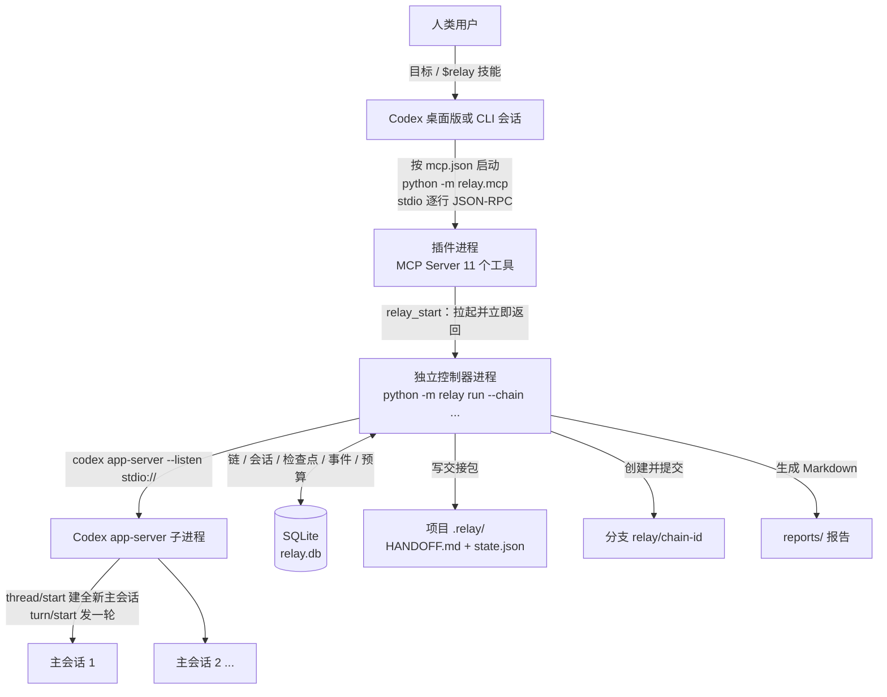

# CodexPotter Relay

**给 Codex 装一根不会断的接力棒。** 提交一次开发目标，Relay 在后台把这件事做完：当会话的上下文接近上限，它先把进度写进项目里的检查点，再开一个**全新**的 Codex 主会话接着干，直到任务完成、验收命令通过，并生成一份可复核的报告。

## 1. 项目简介

一句话：CodexPotter Relay 是一个 Codex 插件 + 本地控制器，把「一个开发目标」执行成「多次全新上下文的接力」。

- **为什么做它**：Codex 单会话的上下文窗口是有限的。任务一长，早期决策被压缩掉，模型开始在旧结论上打转；而每换一次会话，又需要人重新交代背景、手工搬运进度。Relay 把「换上下文」变成一条可编程、可审计的流水线。
- **解决什么问题**：上下文腐烂、跨会话丢进度、没人盯着就不干活、交接靠口头复述。
- **谁适合用**：目标明确、能用一条命令验收的仓库开发任务；希望下班前丢一个目标、第二天早看报告的人；已经在用 Codex 桌面版或 Codex CLI 的 Windows 用户。
- **谁不适合**：需要频繁人类反馈的前端调样式、问答、方案脑暴；以及涉及资金、安全或合规、必须先人工评审的场景。

本项目基于上游 [CodexPotter](README.upstream.md) 二次开发。上游提供 `$loop` 式的「干净上下文多轮收敛」工作方法，本项目把同样的思路做成了独立进程、可恢复、可观测的控制器，并包装成 Codex 插件。

## 2. 核心功能

状态标记：**已实现** = 代码中存在且可执行；**实验性** = 代码存在，但依赖外部环境或只有部分验证；**计划中** = 尚未实现，仅有设计意图。

### 2.1 无人值守接力（已实现）

- **一次提交，自动循环**。`relay start --goal "..."` 创建一个工作链，控制器自己一轮一轮地跑，不需要你在对话里反复说「继续」。每一轮都是一次真实的 Codex 主会话轮次。
- **四级上下文压力阈值**。默认 0.65 写检查点、0.75 准备、0.80 交接、0.90 立即交接。占比只在拿到可靠用量与窗口容量时才计算，不靠猜。
- **真正的全新会话接手**。交接时调用官方 `thread/start` 建新线程；`thread/resume` 只用于「控制器重启后把同一线程重新挂到新进程」，永远不冒充新会话。
- **交接是有状态机的**。PREPARE（写检查点并回读校验）→ START（建新会话）→ VERIFY（新线程零轮次、分支与 HEAD 未被改动）→ COMMIT（转移写权限）→ CONTINUE（新会话必须回 `::relay(...)` 标记才算成功）。任一步失败都有有界重试，最终失败会把链退回原会话或明确转 `failed`。
- **不会无限跑**。轮次、交接次数、模型请求数、可选 token 总量四道预算；连续 3 次轮次失败即终止。

### 2.2 台账与检查点（已实现）

- **项目内的交接包**：`.relay/HANDOFF.md`（给人读的叙述式交接，段落结构沿用上游，便于 `$loop` 继续工作）与 `.relay/state.json`（机器台账：任务、状态、证据、决策、验收命令）。`.relay/` 会被写进项目的 `.gitignore`，这两个文件不会污染你的提交。
- **检查点不只是数据库一行**：它同时固化台账全文与 git 快照（分支、HEAD、脏工作区状态），带校验和。写入时机包括：链启动（`initial`）、每个任务完成（`task:T1`）、压力达阈值（`pressure:<level>`）、交接（`handoff`）、中途追加要求（`requirement`）、手工 `relay checkpoint`。
- **从损坏中恢复**：台账 JSON 坏了会自动回退到最近一个校验和有效的检查点，并把回退后的任务状态同步回数据库，再继续干活。代价是「检查点之后、写盘之前」的进度会重做——这是有意的安全取舍。
- **中途加需求**：`relay require --chain ... --text "..."` 把新要求写进台账并重新渲染交接文件，下一轮或下一次会话起生效。

### 2.3 完成判定与交付证据（已实现）

- **不信任模型自称的「做完了」**。只有台账里所有任务都是 `done`/`unverifiable`、没有 `blocked`、并且所有 `--accept` 验收命令退出码为 0，链才会进入 `complete`。
- **任务级证据**：每个任务带 `evidence` 与 `verified` 标记，报告里逐条列出；「没有任何提交却说做完了」也会被 git 状态识别出来。
- **可重生成的 Markdown 报告**：会话表、交接链、检查点表、任务台账、上下文压力时间线、验收输出、hooks 证据、事件摘要。报告只从数据库生成，崩溃后也能补。

### 2.4 Codex 集成（已实现 + 部分待验证）

- **插件形态**：`relay plugin install` 在本机渲染一个 marketplace 与插件目录（`plugin.json` / `mcp.json` / `skills/relay/SKILL.md`），再通过 `codex plugin marketplace add` 与 `codex plugin add` 注册，注册后**重启 Codex** 生效。
- **11 个 MCP 工具**：`relay_start`、`relay_status`、`relay_chains`、`relay_report`、`relay_add_requirement`、`relay_checkpoint`、`relay_pause`、`relay_resume`、`relay_stop`、`relay_recover`、`relay_doctor`。
- **会话可辨识**（已实现）：每个由 Relay 创建的会话都会调用 `thread/name/set` 命名为 `Relay <chain 短 id> #<序号> · <当前任务>`，并写入分支、HEAD、远端地址元数据。纯协议调用，不消耗模型额度。
- **实验性**：`relay hooks install` 的托管 `[hooks]` 块会写入 Codex 配置，但实测的 Codex `0.167.0-alpha.3.2` **不执行用户配置里的 hook**，状态采集实际走 app-server 通知通道。该能力保留，待 Codex 放开后自动生效。
- **计划中**：桌面版自动弹窗/焦点切换；把新要求注入到**正在执行的那一轮**（需要 `turn/steer` 增强）。

### 2.5 运维与可观测（已实现）

- `relay status` / `relay chains` / `relay history --events` 看状态、事件与交接细节；`--json` 输出机器可读结果。
- `relay pause` / `resume` / `stop` 控制生命周期；`relay handoff` 手动触发一次接力；`relay recover` 接管被强杀的控制器留下的链（先 `--dry-run` 看锁归属）。
- 日志：`%LOCALAPPDATA%\CodexPotterRelay\logs\` 下的控制器输出、app-server stderr、每链日志。

### 2.6 测试体系（已实现）

| 层级 | 命令 | 特点 | 是否消耗额度 |
| --- | --- | --- | --- |
| Level 1 | `relay test --mode mock` | 全部模拟会话与用量，覆盖阈值判定、交接状态机、回滚、预算保护、多项目隔离 | 不消耗 |
| Level 2 | `relay test --mode real-handoff` | 真实创建 A/B/C/D 主会话，只模拟上下文阈值 | 消耗（每个会话一轮） |
| Level 3 | `relay test --mode real-pressure` | 用官方配置把窗口压小，靠真实 token 用量跨阈值，不注入任何模拟占比 | 消耗 |

另有 `relay test-handoff --count N`（连续 N 次真实交接）与 `relay test-report`（重新生成测试报告）。

### 2.7 验证状态速览

- 已记录的真实运行结果（2026-11-10，Windows 11 / Python 3.11.9 / Codex CLI `0.167.0-alpha.3.2`）：Level 1 零真实模型通过；Level 2 连续 3 次交接、4 个真实主会话、验收通过；Level 3 真实占比 80.41% 触发交接；含一次生产项目首跑与一次「杀进程 → `relay recover`」演练。详见 [docs/测试结果.md](docs/测试结果.md)。
- 一次通过≠永远通过：额度、网络、Codex 版本都会改变结果。未验证项与已知限制逐条记录在 [docs/未验证与已知限制.md](docs/未验证与已知限制.md)。

## 3. 工作原理

### 3.1 用大白话说一遍

1. 你给一个目标，Relay 建一条**工作链**；控制器启动时在项目里切出 `relay/<chain-id>` 分支。
2. 控制器开一个 Codex 主会话，把任务清单与规则交代给它。
3. 它跑完一轮，控制器读回 `.relay/state.json`，看任务推进到哪、用了多少 token。
4. 占比到 0.65：写检查点；到 0.75：准备；到 0.80：交接；到 0.90：立即交接（都在一轮结束后的安全边界上做，绝不打断正在写的文件）。
5. 交接 = 把台账 + git 状态固化成检查点，开一个**全新**主会话，让它先读 `.relay/HANDOFF.md` 与 `.relay/state.json`，然后继续下一个任务。
6. 回上一步，直到所有任务完成且验收命令通过 → `complete`，生成报告；或者被暂停、预算用尽、连续失败 → 停下并写清原因。

### 3.2 与 Codex 的交互方式

- 全部走官方 **`codex app-server` 协议**（`--listen stdio://`，逐行 JSON-RPC 2.0），不脚本化 TUI、不模拟键盘。
- `thread/start` 是**唯一**创建新会话的方式，交接必须走它；新线程必须零轮次。
- `thread/resume` 只服务一个场景：控制器进程重启后，把磁盘上仍然存在的同一线程重新挂载进新的 app-server 进程，否则 `turn/start` 会失败。它**不**增加会话数，**不**能当作交接。
- `turn/start` 发一轮、`turn/completed` 收一轮；用量来自 `thread/tokenUsage/updated`，压缩事件来自 `thread/compacted`。
- 无人值守时的审批：app-server 若反过来向 Relay 请求批准，审批类请求默认**拒绝**（权限边界由 `controller.sandbox` 决定），交互式提问以空答案跳过，避免整条链挂在这里。

### 3.3 MCP Server 的职责

插件进程很薄：Codex 按插件里的 `mcp.json` 启动 `python -m relay.mcp`（stdio JSON-RPC），MCP 只实现 `initialize` / `ping` / `tools/list` / `tools/call`（外加返回空列表的 resources、prompts 探测），把 11 个工具映射到同一套 Relay 库。

关键取舍：**控制器不能活在插件进程里**。插件随 Codex 会话生灭，而工作链必须能跨会话、跨 Codex 重启存活，所以 `relay_start` 用脱离进程方式拉起控制器后立即返回。

### 3.4 架构图



### 3.5 三条不变量

- **一条链同时只有一个写者**：数据库执行锁 + 心跳，锁丢了就停。
- **台账是唯一真相**：每一轮都从磁盘重读 `.relay/state.json`，读不出来就从最新有效检查点重建。
- **不编造百分比**：占比 = `last.inputTokens + last.outputTokens` 除以 `modelContextWindow`。`inputTokens` 已包含缓存前缀，所以**不再加** `cachedInputTokens`（加了会双计、把占比虚高到 100%）。缺任一项就显示 `n/a`，改用「压缩事件」与「距上次检查点的轮数」这两个可验证信号。

## 4. 安装与配置

### 4.1 环境要求

| 项目 | 要求 | 说明 |
| --- | --- | --- |
| 系统 | Windows（在 Windows 11 上实测） | 路径与脚本按 Windows 写；核心逻辑有非 Windows 回退，但未验证 |
| Python | 3.11 及以上 | `pyproject.toml` 声明 `requires-python = ">=3.11"`，安装脚本同此要求 |
| Git | Git for Windows | 控制器需要建分支、取快照、提交 `.gitignore` |
| Codex | 含 `app-server` 子命令的 Codex CLI | 可在桌面版内，也可能需要单独安装 |
| 账号 | ChatGPT 已登录 | `relay doctor` 会打印登录状态 |
| 依赖 | 无第三方运行时依赖 | `dependencies = []`，装的是本项目自身 |

### 4.2 安装

推荐一步到位（在仓库根目录执行，无需管理员权限，全部按当前用户安装）：

```powershell
powershell -ExecutionPolicy Bypass -File scripts\install.ps1
```

也可以手工装：

```powershell
python -m pip install -e .
relay init
relay plugin install
```

`relay` 若不在 PATH，可等价的用模块方式调用：

```powershell
python -m relay doctor
```

### 4.3 `scripts\install.ps1` 做了什么

1. 定位 Python 3.11+（依次尝试 `python`、`python3`、`%LOCALAPPDATA%\Programs\Python\Python311` / `312` / `313`，跳过 Microsoft Store 的 0 字节存根）。
2. 定位 git，找不到则提示用 `winget` 安装。
3. 跑一次 `python -m relay doctor`，Codex 不可用就直接失败退出。
4. `pip install -e .` 安装 `relay` 命令，并把 Python 的 `Scripts` 目录去重后加进用户 PATH。
5. `relay init` 生成配置与数据库；`relay plugin install` 注册 Codex 插件（可用 `-SkipPlugin` 跳过）。

可选参数：`-Python <python.exe>`、`-Codex <codex.exe>`、`-WithHooks`、`-SkipPlugin`、`-SkipPath`。安装完请**新开一个终端**，让 PATH 生效。

卸载：

```powershell
powershell -ExecutionPolicy Bypass -File scripts\uninstall.ps1
powershell -ExecutionPolicy Bypass -File scripts\uninstall.ps1 -Purge   # 连工作数据一起删
```

默认保留 `%LOCALAPPDATA%\CodexPotterRelay`（数据库、日志、报告是历史工作链的唯一记录）。

### 4.4 配置

配置文件默认在 `%LOCALAPPDATA%\CodexPotterRelay\relay.toml`（可用 `CODEXPOTTER_RELAY_HOME` 整体改目录，用 `--config` 临时指定）。支持 TOML，也兼容两层 `key: value` 的 YAML 子集（列表、锚点之类会被明确拒绝，不会静默忽略）；**未知段落或未知键会直接报错**，避免写错一个字母就静默关掉安全阈值。

`[relay]` —— 上下文阈值与循环上限：

| 字段 | 默认值 | 含义 |
| --- | --- | --- |
| `checkpoint_threshold` | `0.65` | 到该占比写检查点 |
| `prepare_threshold` | `0.75` | 到该占比进入准备级别 |
| `context_threshold` | `0.80` | 到该占比在下一个安全边界交接 |
| `urgent_threshold` | `0.90` | 到该占比立即在下一个边界交接 |
| `auto_handoff` | `true` | 关掉后只采集、不自动交接 |
| `max_handoffs` | `32` | 单链交接次数上限 |
| `max_turns` | `200` | 单链轮次上限 |
| `max_model_requests` | `400` | 单链模型请求上限 |
| `token_budget` | 未设 | 可选的总 token 硬上限 |
| `model` / `effort` | 未设 | 不设则继承 Codex 自身配置 |
| `max_handoff_retries` | `3` | 一次交接的重试次数 |
| `turn_timeout_seconds` | `7200` | 单轮超时 |
| `fallback_turn_limit` | `40` | 拿不到用量时，距上次检查点多少轮触发准备 |

四个阈值必须严格递增且在 (0, 1] 内。

`[testing]` —— Level 1/2/3 的设置，默认关闭，只有显式跑测试才会用到：

| 字段 | 默认值 | 含义 |
| --- | --- | --- |
| `enabled` | `false` | 测试模式开关 |
| `simulate_context_pressure` | `false` | 注入模拟占比（Level 1/2） |
| `simulated_usage_ratio` | `0.80` | 注入的占比值 |
| `max_handoffs` / `max_model_requests` / `max_turns` | `3` / `16` / `12` | 测试预算 |
| `real_pressure_enabled` | `false` | Level 3 的真实压力开关 |
| `context_window_override` | 未设 | Level 3 默认取 **64000**（官方配置键 `model_context_window`） |
| `auto_compact_token_limit` | 未设 | Level 3 默认取窗口的 **80%**（64000 → 51200） |

`[controller]` —— 进程与连接：

| 字段 | 默认值 | 含义 |
| --- | --- | --- |
| `codex_executable` | 未设 | 不设则按顺序探测（见 FAQ Q4） |
| `sandbox` | `workspace-write` | 传给 app-server 的沙箱模式 |
| `approvals_reviewer` | `auto_review` | 审批复核方 |
| `approval_policy` | `on-request` | 审批策略 |
| `poll_interval_seconds` | `1.0` | 轮询间隔 |
| `startup_timeout_seconds` | `120` | app-server 启动握手超时 |
| `keep_app_server_stdout` | `false` | 是否保留 app-server 原始 stdout |

> 注意：默认配置模板里那两行 `24000` / `16000` 是注释掉的示例值，程序不会读取注释。Level 3 的真实默认值是 `context_window_override = 64000` 与 `auto_compact_token_limit = 51200`（窗口的 80%）。

### 4.5 在 Codex 中启用

```powershell
relay plugin install
```

然后**重启 Codex**（插件、11 个工具和 `$relay` 技能只在重启后加载）。装了什么可以核对：

```powershell
relay plugin status
codex plugin list
```

`relay plugin status` 会打印插件 id、marketplace 目录、是否注册进 Codex 配置、是否进了缓存；`codex plugin list` 里应出现 `codexpotter-relay@codexpotter-relay-local`，状态为 `installed, enabled`。

### 4.6 安装后如何验证

按代价从低到高：

```powershell
relay doctor            # Codex 路径/版本/登录、git、python
relay plugin status     # 插件是否注册（未注册时退出码为 1）
relay test --mode mock  # 零额度端到端自检，最值得先跑这个
```

`relay doctor` 只有在**同时**找到 Codex 与 git 时才返回 0，适合放进脚本当门禁。

## 5. 使用教程

### 5.1 首次运行

```powershell
cd <你的项目路径>
relay doctor
relay start --goal "给 CLI 增加 --json 机器可读输出，不改变人类可读输出" `
            --task "T1:实现 --json 分支" `
            --task "T2:补测试与文档" `
            --accept "python -m pytest -q"
```

`--goal` 必填；不给 `--task` 时会把目标当成唯一任务 `T1`；`--project` 默认为当前目录。启动后会打印链 id、项目路径与工作分支，然后**前台**跑控制器，直到链停下。

想让它脱离终端继续跑：

```powershell
relay start --goal "..." --project <你的项目路径> --detach
```

输出会写到 `%LOCALAPPDATA%\CodexPotterRelay\logs\controller-<chain_id>.out`。

### 5.2 常用操作

| 想做什么 | 命令 |
| --- | --- |
| 看所有链 | `relay chains` |
| 看某条链（缺省为最新一条） | `relay status --chain ch_1a2b3c4d5e6f` |
| 连最近事件一起看 | `relay status --chain ch_1a2b3c4d5e6f --events 20` |
| 看检查点与交接链 | `relay history --chain ch_1a2b3c4d5e6f` |
| 现在立刻写一个检查点 | `relay checkpoint --chain ch_1a2b3c4d5e6f --reason manual` |
| 中途加需求 | `relay require --chain ch_1a2b3c4d5e6f --text "日志必须写 stderr"` |
| 暂停 / 恢复 / 永久停止 | `relay pause` / `relay resume` / `relay stop`（都要 `--chain`） |
| 手动接力一次 | `relay handoff --chain ch_1a2b3c4d5e6f` |
| 生成报告 | `relay report --chain ch_1a2b3c4d5e6f` |
| 崩溃后接管 | `relay recover --dry-run`，确认后 `relay recover` |
| 机器可读输出 | `relay --json status --chain ch_1a2b3c4d5e6f` |

> 全局参数（`--config`、`--db`、`--codex`、`--json`）必须写在子命令**之前**，这是 argparse 的解析顺序决定的。

### 5.3 一个场景演示

需求：给一个 Python CLI 增加 `--json` 输出，并且不破坏原有文本输出。

1. 先确认环境，再在项目里提交当前进度（Relay 会在 `relay/<chain-id>` 分支上工作，未提交的改动会被一起带过去）。

```powershell
cd <你的项目路径>
git status
relay doctor
```

2. 提交目标、拆任务、给验收命令。验收命令是「什么算做完」的唯一客观标准，务必带上。

```powershell
relay start --goal "为 status 子命令增加 --json，人类可读输出保持不变" `
            --task "T1:抽出可序列化的数据结构" `
            --task "T2:实现 --json 分支" `
            --task "T3:补单元测试并更新 README" `
            --accept "python -m pytest -q" `
            --max-turns 40 --max-handoffs 4 --max-model-requests 40
```

3. 让它自己跑。中途可以随时看进度（输出形态示意，数字以实际为准）：

```text
工作链 ch_1a2b3c4d5e6f
  状态: running
  目标: 为 status 子命令增加 --json，人类可读输出保持不变
  项目: <你的项目路径> (relay/ch_1a2b3c4d5e6f)
  活动会话: 01a1c3...
  模型请求: 3
  停止原因: -
```

4. 上下文涨到 0.80 时，你会看到交接记录，并且 Codex 会话列表里多出一个 `Relay 1a2b3c4d #2 · T2 ...` 的新会话——那是**真的新会话**，它自己去读 `.relay/` 里的交接包。

```powershell
relay history --chain ch_1a2b3c4d5e6f
```

5. 跑完看报告，重点看「验收 / Acceptance」与「任务台账」两段：

```powershell
relay report --chain ch_1a2b3c4d5e6f
```

报告落在 `%LOCALAPPDATA%\CodexPotterRelay\reports\`。确认无误后在 Codex 里照常 review 这个分支、合并。

### 5.4 在 Codex 里用

重启 Codex 后，可以直接对话：

```text
用 relay 看看现在有哪些工作链
```

agent 应调用 `relay_chains`。也可以显式触发技能：

```text
$relay 把这个仓库的测试全部改成 pytest 并保证通过
```

技能会引导它先 `relay_doctor`、再 `relay_start`，并提醒它带上 `accept`。

## 6. 注意事项

### 6.1 环境准备

- Codex 必须是**带 `app-server` 子命令**的版本；升级 Codex 后先 `relay doctor` + `relay test --mode mock`，再考虑跑真实任务。
- git 必须能提交：本机没有 `user.name`/`user.email` 时，Relay 会写**仅仓库本地**的身份（`CodexPotter Relay <relay@localhost>`），不改你的全局配置。
- 从「PATH 里没有 Python」的终端启动控制器，验收命令会报 9009；Relay 会把自身解释器目录与 git 目录前置进子进程 PATH，但仍建议用同一个终端环境启动。

### 6.2 权限与数据访问

| 动作 | 范围 | 说明 |
| --- | --- | --- |
| 读写项目文件 | 该项目目录（默认 `workspace-write`） | 超出沙箱的操作需要审批，无人值守时会被拒绝 |
| git 操作 | 创建/切换 `relay/<chain-id>` 分支、提交 `.gitignore`、接管 agent 的提交 | 不碰你的 `main`，不改全局 git 配置 |
| 写 `.relay/` | 项目内 | 自动加入 `.gitignore`，绝不应入库 |
| 写本机状态 | `%LOCALAPPDATA%\CodexPotterRelay\` | 数据库、日志、报告、插件目录、临时测试项目 |
| 改 Codex 配置 | 通过 `codex plugin ...` 注册插件 | 也可写 `[hooks]` 托管块（`relay hooks install`，可选） |
| 调用模型 | 每一轮都是真实请求 | **消耗你的 ChatGPT 额度**，这是唯一不可撤销的成本 |

### 6.3 当前技术限制

- 上下文占比依赖 `thread/tokenUsage/updated` 里的 `modelContextWindow`；拿不到就是 `n/a`，此时靠压缩事件与轮次兜底。
- 交接的最小单位是「主会话」；会话内部的子 Agent 不单独记台账，其产出通过任务证据与 git 提交体现。
- 执行锁的「陈旧判定」只在同主机有效：另一台机器上的控制器会被保守地当作存活。
- 无人值守下的审批一律拒绝（审批类请求默认 `decline`，交互式提问以空答案跳过），所以需要更高权限的操作不会被执行，只会失败而不是被悄悄放行。
- 桌面版自动弹窗、自动聚焦：未实现（会话本身已可见、可命名）。
- hook 通道：托管块能写入，但实测 Codex 版本不执行；以 app-server 通知为准。

### 6.4 已知问题

- `relay status --all` 参数被接受但输出与不带时一致（`--all` 尚未接线），用 `relay chains` 替代。
- `relay resume` 只改数据库状态，**不会**启动控制器；恢复执行要用 `relay recover` 或 `relay run --chain ...`。
- `relay handoff` 需要拿到执行锁：控制器正在跑时会报错，先 `relay pause`。
- 交接失败的回滚路径目前只有 mock 场景验证过（真实 Codex 上未人为制造过交接失败）。
- Codex 侧 475,000 窗口下的「自然长跑把上下文顶到阈值」未实测；已验证的是小窗口（64000）下的同一套代码路径。
- 插件在**重启后的真实会话里被 agent 调用**、`$relay` 技能是否被加载，仍待人工验收。
- 完整清单与逐条复验方法见 [docs/未验证与已知限制.md](docs/未验证与已知限制.md)。

### 6.5 适用范围

适合：目标可写成任务清单、有自动化验收命令、单人或小团队串行开发的中小型仓库重构/功能补齐/测试补齐。

不适合：需要人类边看边改的 UI 调试、需求本身还没想清楚、验收无法自动化、必须人工审批每一步的高风险改动、多人同时改同一分支。

### 6.6 风险与备份建议

- **先备份或先提交**。控制器启动时会在项目里新建并切到 `relay/<chain-id>` 分支；工作区里未提交的改动会一起带过去。
- 不要在两个终端里对同一个项目跑两条链：它们会抢同一个工作区。
- `.relay/` 永不入库；`.relay/HANDOFF.md` 与 `state.json` 是断点续跑的唯一凭据，删了就只能退回数据库里的检查点。
- 报告与数据库是历史证据，`uninstall.ps1` 默认保留，`-Purge` 才会删。
- 交接后旧会话仍留在 Codex 列表里，但**不再拥有写权限**；不要在旧会话里继续改同一个项目。

## 7. FAQ

### Q1. 安装脚本报 “Python 3.11+ not found” 或 “Codex CLI is not usable”

先手工确认两者可用，再重跑脚本：

```powershell
python --version
codex --version
codex login status
powershell -ExecutionPolicy Bypass -File scripts\install.ps1 -Python <python.exe> -Codex <codex.exe>
```

Codex 没登录时 `relay doctor` 会打印登录状态；登录后再装。

### Q2. 插件装了，但 Codex 里看不到 relay 工具

按顺序查：`relay plugin status` 看 `registered in Codex config` 是否为 `True`；`codex plugin list` 里是否有 `codexpotter-relay@codexpotter-relay-local`；然后**完全退出并重启 Codex**（不是新开一个标签页）。仍未出现时，用 `python -m relay doctor` 确认 Python 与包路径没问题——插件里的 `mcp.json` 记录的是安装时那个解释器的绝对路径，换了解释器需要重跑 `relay plugin install`。

### Q3. `relay` 命令找不到（不是内部或外部命令）

安装器只改了**用户** PATH，已开的终端不会自动刷新：

```powershell
# 新开一个终端后重试，或临时用模块方式调用
python -m relay status
```

也可以直接 `python -m relay ...`，两者行为完全一致（`relay` 脚本就是 `relay.cli:main`）。

### Q4. Codex 可执行文件是怎么被找到的？

固定顺序：`--codex` 参数 → 环境变量 `CODEXPOTTER_CODEX` → PATH 里的 `codex` → `%LOCALAPPDATA%\OpenAI\Codex\bin\*\codex.exe`（同目录多版本时取体积最大的）→ `%LOCALAPPDATA%\Programs\codex\codex.exe`。想固定下来，就在 `relay.toml` 的 `[controller] codex_executable` 写绝对路径。

### Q5. 验收命令报 exit code 9009

9009 是 Windows 的「找不到命令」，几乎总是 PATH 里没有 `python`。Relay 启动时会把自身解释器目录前置进子进程 PATH，但如果你的验收命令写的是别的工具（`node`、`npm`、`pnpm`），需要那个工具也在 PATH 里。排查：

```powershell
relay doctor
python -c "import sys; print(sys.executable)"
```

稳妥写法是在 `--accept` 里用与 `relay doctor` 输出的同一个解释器路径，或改用可被 PATH 解析的命令。

### Q6. 为什么报告里的上下文占比是 `n/a`？

因为没同时拿到「可靠用量」和「窗口容量」。占比只在收到 `thread/tokenUsage/updated` 且其中含 `modelContextWindow` 时计算，公式是 `last.inputTokens + last.outputTokens`（**不**再加 `cachedInputTokens`，它已包含在 `inputTokens` 里）。缺数据时 Relay 不猜：改用「观测到压缩事件即按窗口已满交接」和「距上次检查点 40 轮进入准备」两个可验证信号，报告里就显示 `n/a` 与 `source=unavailable`。

### Q7. 能接管我已经手打的会话吗？

不能。Relay 只驱动自己用 `thread/start` 创建的会话，交接时也强制要求新线程零轮次。你能接管的是一条**工作链**：控制器被杀后 `relay recover` 会把链里那条线程 `thread/resume` 重新挂到新进程上继续，而不是接管你的聊天会话。想让某个已有仓库开始接力，就 `relay start --goal "..." --project <该仓库>`。

### Q8. 一次任务大概消耗多少额度？

每个轮次 = 一次真实模型请求。已记录的 Level 2 演示是「4 个会话各一轮」，Level 3 的预算是「最多 6 轮、8 次请求」。真实任务建议一开始就收紧预算：

```powershell
relay start --goal "..." --project <你的项目路径> --max-turns 20 --max-handoffs 3 --max-model-requests 20
```

先用小的预算跑通，再放开。`relay test --mode mock` 完全不消耗额度。

### Q9. 能同时跑多条链 / 多个项目吗？

技术上可以，但不建议对**同一个项目**并发：两条链会抢同一个工作区、同一个 `.relay/` 目录和同一把分支。不同项目各自一条链是安全的（Level 1 有多项目隔离判定）。控制器的模型调用本身是一条链一个轮次的同步循环，不存在「一轮里并发多请求」。

### Q10. 升级 Codex 后要不要重装插件？

要重新跑一次 `relay plugin install`（它会重新渲染 `mcp.json`、重新注册），再重启 Codex。升级后建议顺序：`relay doctor` → `relay test --mode mock` → 需要时 `relay test-handoff --count 1`。

## 8. 版本信息

- 当前版本：**0.1.0**（`relay/plugin.py` 的 `PLUGIN_VERSION` 与 `pyproject.toml` 的 `version` 一致）。
- 数据库 schema 版本：1（`relay.db`，迁移只向前）。
- 维护状态：0.1.x 开发阶段，尚未对 CLI 参数、配置键和所依赖的 app-server 协议字段做稳定承诺；升级前请先跑 §4.6 的验证命令。
- 版本变更记录：见 `CHANGELOG.md`。该文件目前尚未建立，在它补齐之前以 `git log` 与 [docs/测试结果.md](docs/测试结果.md) 为准——后者按日期记录了每次实测结论与当次修复的缺陷。

## 9. 贡献与反馈

- **报问题**：在仓库 issue 里写清「期望 / 实际 / 复现命令 / `relay doctor` 输出 / 相关链 id」，并附上 `%LOCALAPPDATA%\CodexPotterRelay\logs\` 里对应的日志片段（贴之前确认没有敏感路径与 token）。
- **提建议**：说明使用场景与现在的替代做法。涉及「新增阈值」「新增命令」的建议，请一并说明它如何被验证——本项目不接受只有描述、没有复验方法的完成声明。
- **参与开发**：流程与提交约定见 `CONTRIBUTING.md`（该文件尚未建立时，以本段列出的最低要求为准）。最低要求：改动先跑 `python -m unittest discover -s tests -q`，再跑零额度的 `relay test --mode mock`；改动涉及真实会话路径时，补一次 `relay test-handoff --count 1`。
- **私有仓库协作方式**：本仓库若为私有，协作者需被邀请获得读/写权限；外部贡献通过内部 issue 或受控 PR 进行，不接受公开镜像分发。提交 PR 时请说明对应 issue、改动范围与验证证据（命令 + 输出摘要 + 报告文件名）。

## 许可证

本项目以 **Apache-2.0** 许可证发布，全文见 [LICENSE](LICENSE)。

- 上游项目：[breezewish/CodexPotter](https://github.com/breezewish/CodexPotter)，Apache-2.0，版权归其作者所有。其 `$loop` 工作方法、交接文件的段落结构与本项目的设计取向均源自上游。
- 本仓库的改动：以独立进程实现无人值守控制器（而非在会话内循环）、把交接做成带校验与回滚的状态机、增加 SQLite 台账与检查点恢复、上下文压力四级阈值、三层测试体系、以及 Codex 插件（MCP + 技能 + marketplace）封装。上游实现的版权声明与许可条款继续适用；本项目新增部分同样以 Apache-2.0 授权。
