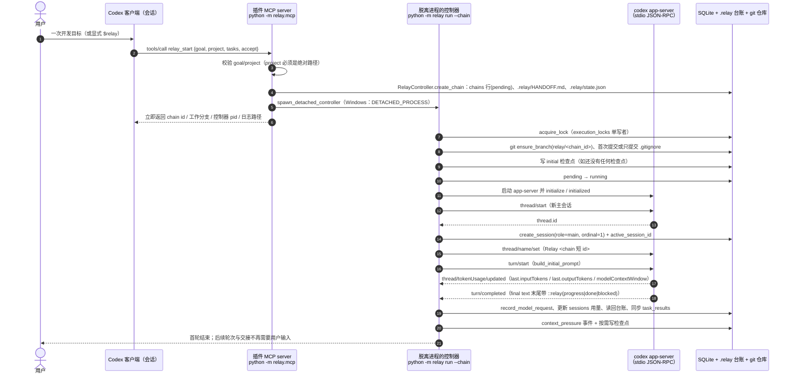
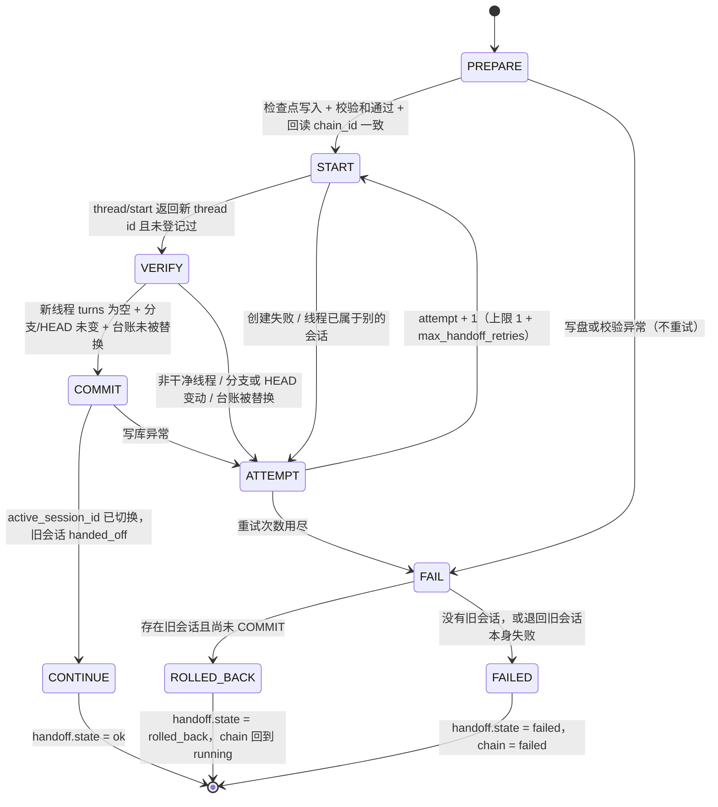

# CodexPotter Relay 架构说明 / Architecture

本文只描述**代码里已经存在的东西**。所有类名、函数名、表名、字段名、协议消息名均可在仓库
`relay/`、`tests/`、`pyproject.toml`、`scripts/` 中直接找到；凡是尚未验证、或与需求文字有差异
的地方，本文不掩饰，统一指向 [未验证与已知限制.md](未验证与已知限制.md) 的具体条目编号。

- 权威来源：`relay/*.py`（实现）、`docs/测试结果.md`（实测结论）、`docs/未验证与已知限制.md`（未验证项）
- 版本：`relay/plugin.py` 的 `PLUGIN_VERSION` 与 `pyproject.toml` 的 `version` 同为 `0.1.0`
- 适用运行环境：Windows 11、Python 3.11+、Git for Windows、Codex CLI 含 `app-server` 子命令

---

## 1. 分层与模块职责

### 1.1 分层视图

```text
┌─ 接口层 ───────────────────────────────────────────────────────────────┐
│ cli.py（命令行）      mcp.py（插件 MCP server）      plugin.py（插件打包）│
└───────────────┬──────────────────────┬──────────────────────┬──────────┘
                │                      │                      │
┌─ 控制层 ──────▼──────────────────────▼──────────────────────▼──────────┐
│ controller.py（单链控制循环）      handoff.py（交接状态机）              │
│ ops.py（控制器之外的手动动作）     prompts.py（提示词与标记协议）        │
└───────────────┬──────────────────────┬─────────────────────────────────┘
                │                      │
┌─ 会话驱动层 ──▼──────────────────────▼─────────────────────────────────┐
│ agent_session.py（线程/turn/用量）      appserver.py（stdio JSON-RPC）   │
│ mock_agent.py（零额度假驱动，仅测试用）                                   │
└───────────────┬────────────────────────────────────────────────────────┘
                │
┌─ 状态与持久化 ─▼───────────────────────────────────────────────────────┐
│ db.py（SQLite：链/会话/事件/检查点/交接/任务/锁/预算计数）                │
│ checkpoint.py（git 快照 + .relay 交接包读写与校验）                      │
└───────────────┬────────────────────────────────────────────────────────┘
                │
┌─ 判定与呈现 ──▼────────────────────────────────────────────────────────┐
│ context_monitor.py（压力判定）  validator.py（完成判定）                  │
│ report.py（Markdown 报告）      hooks.py（hooks 采集与托管块）            │
└───────────────┬────────────────────────────────────────────────────────┘
                │
┌─ 支撑 ────────▼────────────────────────────────────────────────────────┐
│ config.py（配置）  paths.py（路径）  codex_env.py（定位 codex/python）    │
│ logging_setup.py（JSONL 日志）  tests_runner.py（三层测试执行器）         │
└─────────────────────────────────────────────────────────────────────────┘
```

### 1.2 模块职责表

| 模块 | 一句话职责 | 关键类 / 函数 |
| --- | --- | --- |
| `relay/__init__.py` | 包入口，导出公开入口说明与版本号 | `__version__` |
| `relay/__main__.py` | 让 `python -m relay` 等价于 `relay` 脚本 | `main`（转发 `relay.cli.main`） |
| `relay/paths.py` | 解析全部文件系统位置：状态目录、数据库、配置、日志、Codex home、项目 `.relay/` | `relay_home`、`database_path`、`config_path`、`log_dir`、`chains_dir`、`test_workspace_root`、`codex_home`、`project_state_dir`、`ensure_directory`、`PROJECT_STATE_DIR` |
| `relay/config.py` | 解析并校验 TOML 或文档中的 YAML 子集；未知段/未知键/乱序阈值一律报错 | `RelayConfig`、`RelaySettings`、`TestingSettings`、`ControllerSettings`、`load_config`、`parse_config_text`、`write_default_config`、`ConfigError`、`DEFAULT_CONFIG_TEMPLATE` |
| `relay/codex_env.py` | 按固定顺序定位 `codex` 可执行文件，读版本与登录状态，把 python/git 目录补进子进程 `PATH` | `find_codex_executable`、`codex_version`、`codex_login_status`、`ensure_python_on_path`、`CodexNotFoundError` |
| `relay/appserver.py` | 拥有一个 `codex app-server` 子进程：`initialize` 握手、`request`/`notify`、应答服务器端请求 | `AppServer`、`UnattendedPolicy`、`ServerRequestAnswer`、`AppServerError`、`AppServerUnavailable`、`_PendingRequest` |
| `relay/agent_session.py` | 把 app-server 协议翻译成「线程 / turn / token 用量 / 压缩事件」抽象并跟踪每线程状态 | `CodexAgent`、`TokenUsage`、`ThreadState`、`TurnOutcome`、`SessionError`、`TERMINAL_TURN_STATUSES` |
| `relay/context_monitor.py` | 把线程观测映射为检查点/准备/交接/紧急决策，测不到就退回可验证信号 | `ContextMonitor`、`PressureSample`、`PressureDecision`、`LEVEL_*`、`SOURCE_*` |
| `relay/db.py` | SQLite 持久化与不变量：前向迁移、链状态机、事件幂等、检查点校验和、单写者锁、预算计数 | `Database`、`Chain`、`Session`、`Checkpoint`、`Handoff`、`MIGRATIONS`、`Migration`、`checkpoint_checksum`、`CHAIN_TRANSITIONS`、`HANDOFF_PHASES` |
| `relay/checkpoint.py` | git 快照与 `.relay/HANDOFF.md` + `.relay/state.json` 交接包（原子写、结构校验） | `GitRepository`、`GitSnapshot`、`HandoffPackage`、`read_package`、`write_package`、`ensure_scaffold`、`validate_state`、`default_state`、`build_handoff_markdown`、`all_tasks_done`、`next_pending_task` |
| `relay/handoff.py` | 执行 `PREPARE → START → VERIFY → COMMIT → CONTINUE` 状态机，含有限重试与回滚 | `HandoffManager`、`HandoffResult`、`HandoffError`、`SessionDriver`、`parse_marker`、`MARKER_PATTERN` |
| `relay/controller.py` | 单链控制循环：预算、重连、提示词选择、压力采样、检查点、交接、报告 | `RelayController`、`Budget`、`ChainRunResult`、`BudgetExceeded`、`MAX_TURN_FAILURES`、`TERMINAL_CHAIN_STATES` |
| `relay/ops.py` | 控制器之外的运维动作，全部复用同一套实现（不另写捷径） | `capture_checkpoint`、`manual_handoff`、`spawn_detached_controller`、`append_requirement`、`pause_chain`、`resume_chain`、`stop_chain`、`make_event_sink`、`doctor` |
| `relay/prompts.py` | 集中管理发给会话的四类提示词与标记协议 | `build_initial_prompt`、`build_resume_prompt`、`build_continue_prompt`、`build_repair_prompt`、`RELAY_MARKER_PROGRESS` / `_DONE` / `_BLOCKED` |
| `relay/validator.py` | 完成判定的唯一来源：台账 + 验收命令 + git 状态，不采信自我声明 | `TaskValidator`、`ValidationReport`、`AcceptanceResult` |
| `relay/report.py` | 从数据库渲染 Markdown 报告，可对任意链重复生成 | `build_chain_report`、`write_chain_report`、`write_test_report` |
| `relay/hooks.py` | hooks 采集器与 `config.toml` 托管块的安装/卸载/回读，区分「已写入」与「实际执行」 | `HookInstaller`、`run_hook_command`、`collect_hook_event`、`hooks_observed`、`app_server_hook_events`、`summarize_event_sources`、`ALL_EVENTS` |
| `relay/logging_setup.py` | JSON Lines 结构化日志（行内带 `relay_fields`） | `configure_logging`、`JsonLineFormatter`、`log_event` |
| `relay/mcp.py` | MCP stdio 服务器与工具表；`relay_start` 负责把控制器脱离进程拉起 | `McpServer`、`RelayToolbox`、`ToolResult`、`PROTOCOL_VERSIONS`、`SERVER_NAME` |
| `relay/plugin.py` | 渲染并注册 Codex 插件（marketplace + 插件清单 + `mcp.json` + `$relay` 技能） | `render_plugin`、`install_plugin`、`uninstall_plugin`、`plugin_status`、`plugin_paths`、`PluginPaths`、`PLUGIN_VERSION` |
| `relay/cli.py` | 命令行入口与子命令分发，是链的唯一受支持入口 | `main`、`build_parser`、`_dispatch`、`_run_controller`、`_spawn_detached`、`production_database`、`test_database` |
| `relay/mock_agent.py` | 零额度假驱动：真实推进台账/git，可注入失败、卡死、台账损坏 | `MockAgent`、`MockBehaviour`、`clone_behaviour` |
| `relay/tests_runner.py` | 三层测试执行器与判定项聚合 | `run_level1`、`run_level2`、`run_level3`、`TestOutcome`、`Check`、`LEVEL1`/`LEVEL2`/`LEVEL3` |

---

## 2. 进程与连接模型

### 2.1 四个进程角色

| 角色 | 生命周期 | 代码位置 | 说明 |
| --- | --- | --- | --- |
| Codex 客户端（CLI / 桌面版） | 用户会话 | 外部 | 只会通过插件调用 MCP 工具，或直接跑 `relay` 命令 |
| 插件 MCP server | **随 Codex 会话生灭** | `relay.mcp.main`（`python -m relay.mcp`） | stdio 上的换行分隔 JSON-RPC 2.0；只实现 `initialize`、`ping`、`tools/list`、`tools/call` 等 Codex 实际调用的方法 |
| 控制器 | 独立、**脱离进程** | `python -m relay run --chain <id>`（`ops.spawn_detached_controller`） | 一条链一个写者；插件或 CLI 都只负责拉起它，不等它结束 |
| `codex app-server` | 由**控制器** spawn 并管理 | `appserver.AppServer.start` | `codex app-server --listen stdio://`，一次运行一个；线程存储与桌面版共享 `~/.codex`（受 `CODEX_HOME` 影响） |

关键点：**控制器不寄生在插件进程里**。`relay/mcp.py` 的模块注释写明了原因——插件 server 会随会话启动和退出，
而工作链必须活得比任何会话、任何 Codex 重启都久。所以 `relay_start` 的流程是「建链 → 拉起脱离进程 → 立即返回」。

### 2.2 一次 `relay_start` 到首轮结束（时序图）



时序里的每一步都能在代码里对上：`RelayToolbox._start` → `RelayController.create_chain` → `ops.spawn_detached_controller`
→ `RelayController._run_locked` → `_prepare_environment` → `_start_initial_session` → `_run_work_turn` → `_sample_pressure`。

### 2.3 重连语义：`thread/start` 与 `thread/resume` 分工

- `thread/start`：**唯一**创建新主会话的方式，交接的 `START` 阶段只用它。
- `thread/resume`：只用于控制器重启后把已存在的线程重新挂载进新的 app-server 进程（`CodexAgent.attach_thread`）。
  新 spawn 的 app-server 从未加载过旧 thread，直接 `turn/start` 会失败；resume 让链继续在**同一个**会话上跑，
  不增加会话数，因此它不是交接的替代品。
- 线程真丢失时（`thread/resume` 报错），`RelayController._reattach_active_session` 记 `session_lost` 事件、
  把旧会话标 `failed`、清空 `active_session_id`，随后由 `_start_initial_session` 新建会话并递增序号。

---

## 3. 交接状态机

### 3.1 状态图



对应实现：`HandoffManager.run`（主循环）与 `HandoffManager._fail`（唯一失败出口）；阶段内动作分别是
`_prepare`、`_start`、`_verify`、`_commit`，`_abandon_session` 负责把失败的候选会话标成 `failed`。

### 3.2 每个阶段到底校验什么

| 阶段 | 实际动作 | 失败即放弃的条件 |
| --- | --- | --- |
| `PREPARE` | 调 `write_checkpoint("handoff")` 写检查点；`Checkpoint.is_intact()` 复算校验和；`read_package` 从磁盘回读 | 校验和不符；回读失败；`state.json` 的 `chain_id` 不是本链 |
| `START` | 取下一个主会话序号；`driver.start_thread(...)` 真正新建线程；`db.find_session` 判重；`create_session(role=main)` | `thread/start` 报错；返回的 thread id 已在 `sessions` 里 |
| `VERIFY` | `driver.read_thread` 取 `turns`；`git.snapshot()` 比对分支与 HEAD；再读一次台账 | `turns` 非空；分支与 `checkpoint.git_branch` 不同；`checkpoint.git_head` 存在而 HEAD 已变；台账 `chain_id` 被换 |
| `COMMIT` | 旧会话 → `handed_off` + `ended_at`；新会话 → `active`；`chains.active_session_id` 更新、链状态回 `running` | 任一写库异常（此时写权限尚未真正转移，可重试） |
| `CONTINUE` | 标记 handoff `phase=CONTINUE, state=ok, finished`；返回 `HandoffResult`；控制器的下一次 turn 发送 `build_resume_prompt` | —（成功即返回） |

`VERIFY` 通过后会调用 `db.mark_checkpoint_verified` 记下 `verified_at`，报告里的 `Verified` 列即来源于此。

### 3.3 重试与回滚语义

- 重试次数：`1 + config.relay.max_handoff_retries`（默认 `max_handoff_retries = 3`，即最多 4 次），**每次都是全新线程**。
- 失败出口只有一处：`HandoffManager._fail`。
  - 若能退回旧会话（存在 `previous_session` 且未 COMMIT）：`update_chain(active_session_id=旧会话, state="running")`，
    handoff 记 `rolled_back`，`HandoffResult.rolled_back = True`；PREPARE 写下的检查点保留不动。
  - 否则链转 `failed`，handoff 记 `failed`，错误文本写入 `handoffs.error`。
- 控制器侧：交接失败会结束本轮循环并以 `handoff failed: ...` 作为停止原因；崩溃发生在 `handoff` 状态时，
  `_recover_inflight_handoff` 会把未完成的交接标成 `failed`、链退回 `running`，并记 `handoff_recovered` 事件。

### 3.4 工作链状态机（`db.CHAIN_TRANSITIONS`）

| 当前状态 | 允许迁移到 |
| --- | --- |
| `pending` | `running`、`paused`、`stopped`、`failed` |
| `running` | `handoff`、`paused`、`stopped`、`complete`、`failed` |
| `handoff` | `running`、`failed`、`stopped` |
| `paused` | `running`、`handoff`、`stopped`、`failed` |
| `complete` / `stopped` / `failed` | 终态，无出边 |

非法迁移由 `Database.transition_chain` 抛 `TransitionError`，避免崩溃后留下不可能的状态。
`pending → paused` 与 `paused → handoff` 是后来放开的两条边（记录在 [测试结果.md](测试结果.md) 第 6.3 节末尾的缺陷说明里）。

---

## 4. 数据模型

### 4.1 表与字段用途

默认位置 `<relay home>/relay.db`（Windows：`%LOCALAPPDATA%\CodexPotterRelay\relay.db`），测试库
`relay-test.db` 物理隔离；连接参数是 WAL + `busy_timeout` + 每线程一个连接（`Database._connection`）。

| 表 | 一行代表 | 关键字段与用途 |
| --- | --- | --- |
| `chains` | 一个用户目标（可跨多个主会话） | `id`（`ch_` + 12 位 hex）、`project_root`、`goal`、`mode`(`production`/`test`)、`test_level`、`state`、`active_session_id`（写权限归属）、`work_branch`（`relay/<chain_id>`）、`created_at`/`updated_at`/`completed_at`、`stop_reason`、`config_json`（建链时的阈值/任务/验收快照）、`simulated` |
| `sessions` | 一个 Codex 主线程（或子会话行） | `id`（即 thread id）、`chain_id`、`ordinal`（主会话序号 1、2、3…）、`role`(`main`/`subagent`)、`parent_session_id`、`model`、`state`、`started_at`/`ended_at`/`last_activity_at`、`token_input` / `token_cached` / `token_output` / `token_total`、`context_window`、`request_count`、`metadata_json`；索引 `sessions_main_ordinal` 保证同一链的序号唯一 |
| `events` | 一条不可变事件 | `kind`、`source`（`controller`/`appserver`/`monitor`/`hook`）、`event_key`（**唯一**）、`occurred_at`、`payload_json`、`chain_id`、`session_id`、`simulated` |
| `checkpoints` | 一次可恢复快照 | `version`（每链递增、唯一）、`reason`（`initial` / `task:<id>` / `pressure:<level>` / `handoff` / `requirement` / 手动）、`git_head`、`git_branch`、`git_dirty`、`git_status_text`、`handoff_sha256`、`handoff_md`（全文）、`state_json`（台账全文）、`checksum`、`verified_at`、`session_id` |
| `handoffs` | 一次交接执行 | `sequence`（每链递增、唯一）、`from_session_id`、`to_session_id`、`phase`（五阶段）、`state`（`pending`/`ok`/`failed`/`rolled_back`）、`checkpoint_id`、`attempt`、`started_at`/`updated_at`/`finished_at`、`error`、`details_json`、`simulated` |
| `task_results` | 台账任务的数据库镜像 | `task_id`（每链唯一）、`title`、`status`、`evidence`、`session_id`、`verified`、`updated_at`；由 `RelayController._sync_tasks` 从 `.relay/state.json` 同步 |
| `execution_locks` | 单写者锁 | `chain_id`（主键）、`owner_pid`、`owner_host`、`acquired_at`、`heartbeat_at` |
| `model_requests` | 一次模型请求计数（预算依据） | `chain_id`、`session_id`、`kind`、`started_at`、`finished_at`、`simulated`；`count_model_requests(chain_id, simulated=...)` 分别统计真实/模拟请求 |

### 4.2 迁移机制

- 迁移是**前向、只增不改**的元组：`db.MIGRATIONS`，每项是一支 `Migration(version, description, statements)`。
- 已应用版本记在 `schema_migrations` 表；`Database.migrate()` 逐条在 `BEGIN IMMEDIATE` 事务内执行语句并写入
  `(version, description, applied_at)`，任一语句失败整支回滚。
- 当前有两支：`version=1`（初始 schema：八张表与索引）、`version=2`（把 Level 2/3 真实会话测试链的
  `model_requests.simulated` 纠正为 0）。
- `db.SCHEMA_VERSION = 1` 是初始 schema 的基线常量；实际迁移头以 `schema_migrations` 的 `MAX(version)` 为准
  （当前为 2），`relay init` 打印的是迁移头而不是这个常量。
- 新增迁移必须**追加新版本号**，不得修改已发布语句——已升级过的库不会重跑旧版本。

### 4.3 检查点校验和

- `db.checkpoint_checksum` 对以下内容的规范化 JSON（`canonical_json`：`sort_keys=True`、紧凑分隔符）
  计算 SHA-256：`chain_id`、`version`、`git_head`、`git_branch`、`handoff_sha256`、`state_json`。
- `handoff_sha256 = sha256(HANDOFF.md 全文)`；`Checkpoint.is_intact()` 同时复算这两层。
- 读取链状态时用 `latest_valid_checkpoint`：从最新版本往前找第一支 `is_intact()` 为真的检查点，
  损坏的行不会被用来恢复（恢复语义见 [测试结果.md](测试结果.md) 第 8 节）。

### 4.4 幂等事件键

`events.event_key` 是 `UNIQUE`，写入走 `INSERT OR IGNORE`，`Database.append_event` 返回是否真的插入了新行。
事件键的构造方式（都在调用点可见）：

| 事件 | 键 |
| --- | --- |
| 建链 | `<chain>:chain-created` |
| 会话开始 | `<chain>:session-started:<session>` |
| 一轮结束 | `<chain>:turn:<turn_id>` |
| 压力采样 | `<chain>:pressure:<session>:<毫秒时间戳>` |
| 检查点 | `<chain>:checkpoint:<checkpoint_id>` |
| 交接开始/结束 | `<chain>:handoff-start:<seq>`、`<chain>:handoff-end:<seq>` |
| 验收 | `<chain>:validation:<毫秒时间戳>` |
| 恢复/修复 | `<chain>:handoff-recovered:<handoff_id>`、`<chain>:state-restored:<cp>`、`<chain>:ledger-repaired:<cp>:<ms>` |
| hooks | 载荷里的 `eventKey`，否则 `hook:<event>:<chain>:<session>:<turn>:<ts>` |

因此 hook 或通知被重复投递时不会产生重复行；反过来，任何含毫秒时间戳的键天然不会去重，只用于「一次采样一次记录」。

### 4.5 单写者锁

- `acquire_lock(chain_id)`：链上已有锁且未陈旧 → 只有同 pid 同 host 才算持有成功；否则插入 `(pid, host, now, now)`。
- `heartbeat_lock`：每轮刷新 `heartbeat_at`，刷新失败即认为锁易主，控制器以 `lost the chain execution lock` 结束。
- `release_lock`：只删自己持有的锁。
- 陈旧判定（`_lock_is_stale`）：**不同主机一律视为可能存活**，同主机才用 `_process_alive`（Windows 走
  `OpenProcess` + `WaitForSingleObject`，其他平台 `os.kill(pid, 0)`）检查 pid。跨主机不回收是有意为之，
  见 [未验证与已知限制.md](未验证与已知限制.md) 第 9 条。

---

## 5. 上下文压力算法与阈值语义

### 5.1 采样来源

`ContextMonitor.sample(thread_state)` 只认三种来源（常量在 `context_monitor.py`）：

| `source` | 何时出现 | 是否可信 |
| --- | --- | --- |
| `real` | `thread/tokenUsage/updated` 同时给出 `last` 用量与 `modelContextWindow` | 可信，直接算占比 |
| `simulated` | 测试显式注入 `simulated_ratio`（Level 1/2） | 可信但**明确标记为模拟**，事件与报告都带 `simulated` |
| `unavailable` | 没有用量、或没有上下文容量 | 不算占比，只走回落信号 |

`SOURCE_FALLBACK` 常量已定义但当前样本不会产出它（回落由 `decide()` 的判定文本体现），
见 [未验证与已知限制.md](未验证与已知限制.md) 第 6 条。

### 5.2 占比公式（只有这一种）

```text
context_used = last.inputTokens + last.outputTokens
ratio        = min(1.0, context_used / modelContextWindow)
```

`TokenUsage.context_used_tokens()` 就是这个式子。**不加 `cachedInputTokens`**：`inputTokens` 已经包含缓存前缀，
再加一次会把占比算高（这一缺陷曾被真实 Level 3 测试暴露并修复，见 [测试结果.md](测试结果.md) 第 3 节）。
`cachedInputTokens` 与 `reasoningOutputTokens` 仍然被记录（`sessions.token_cached` 与内存状态），只是不参与占比。

### 5.3 阈值 → 级别 → 动作

阈值默认值与校验规则来自 `config.RelaySettings`（必须落在 `(0,1]` 且严格递增），判定顺序在 `ContextMonitor.decide`：

| 占比 | 级别 | 控制器动作（默认 `auto_handoff=true`） |
| --- | --- | --- |
| `< 0.65` | `ok` | 继续下一轮 |
| `≥ 0.65` | `checkpoint` | 该轮结束后写 `reason=pressure:checkpoint` 的检查点 |
| `≥ 0.75` | `prepare` | 同上，写 `reason=pressure:prepare` 的检查点；完整交接包留到交接的 `PREPARE` 阶段现写现校验 |
| `≥ 0.80` | `handoff` | 在下一个安全边界执行交接状态机 |
| `≥ 0.90` | `urgent` | 同样在安全边界交接，级别与原因记为 urgent（不打断进行中的写入） |

采样点固定在 `RelayController._sample_pressure`：**一轮 turn 结束之后**，因此交接永远落在安全边界，
不会中断正在写入的操作。`auto_handoff=false` 或交接次数已达
`max_handoffs` 时不做交接，后者会把链置 `stopped`（`handoff budget exhausted`）。

### 5.4 无法测量时的回落（绝不伪造百分比）

`decide()` 在 `sample.ratio is None` 时只使用两种可验证信号：

| 条件 | 级别 | 原因文本要点 |
| --- | --- | --- |
| 观测到压缩事件（`thread/compacted` 计数 > 0） | `handoff` | `context compaction observed (Nx); treating the window as full without inventing a percentage` |
| 距上次检查点的轮次 ≥ `fallback_turn_limit`（默认 40） | `prepare` | `<N> turns since the last checkpoint (fallback limit 40)` |
| 其他 | `ok` | `no reliable context usage reported; relying on turn counting` |

压缩事件由 `CodexAgent._on_notification` 对 `thread/compacted` 与 `thread/compact/completed` 计数。
报告里这类行的 `Ratio` 显示为 `n/a`、`Source` 显示 `unavailable`，不写任何估算值。

### 5.5 检查点触发点

| `reason` | 触发者 | 目的 |
| --- | --- | --- |
| `initial` | 控制器启动时，若链还没有任何检查点 | 给未跨阈值的链一个 git 锚定的基线，崩溃可恢复 |
| `task:<id>` | 每个任务由未完成变 `done` 且这一轮不交接 | 把已完成进度钉住，台账损坏时最多回退一小步 |
| `pressure:<level>` | 压力级别 ≥ `checkpoint` 且这一轮不交接 | 阈值驱动的常规快照 |
| `handoff` | 交接的 `PREPARE` 阶段 | 交接包必须现写现校验 |
| `requirement` | `relay require` / `relay_add_requirement` | 新要求入台账并立刻可被下一次读取看到 |
| 任意文本 | `relay checkpoint --reason ...` / `relay_checkpoint` 工具 | 人工快照 |

---

## 6. 交接的关键不变量

以下每一条都在代码里有强制点；改代码时不要削弱其中任何一条。

| 编号 | 不变量 | 强制位置 |
| --- | --- | --- |
| I1 | **新线程必须是空的**：`thread/read` 返回的 `turns` 必须为空 | `HandoffManager._verify` |
| I2 | **分支与 HEAD 必须与检查点一致**：分支不同即失败；检查点有 `git_head` 时 HEAD 移动即失败 | `HandoffManager._verify` + `GitSnapshot` |
| I3 | **链归属一致**：`PREPARE` 回读与 `VERIFY` 复读的 `.relay/state.json`，其 `chain_id` 必须是本链 | `HandoffManager._prepare` / `_verify` |
| I4 | **单写者**：一条链同时只有一个控制器持有 `execution_locks`；`chains.active_session_id` 任一时刻只指向一个会话，切换只在 `COMMIT` 内发生且由同一个控制器串行完成 | `Database.acquire_lock` / `heartbeat_lock`，`HandoffManager._commit` |
| I5 | **台账目录 `.relay/` 不入库**：`ensure_scaffold` 自动把 `.relay/` 写进项目 `.gitignore`；`HANDOFF.md` 的规则第 6 条（"Never commit `.relay/**`"）也明确禁止提交 | `checkpoint.ensure_scaffold`、`checkpoint.HANDOFF_RULES`、`controller._prepare_environment`（只提交 `.gitignore` 本身） |
| I6 | **只在 `relay/<chain_id>` 分支工作**：链创建时确定分支名，控制器启动时 `ensure_branch` 切过去，`VERIFY` 再确认没有漂移 | `RelayController.create_chain`（`work_branch = relay/<chain_id>`）、`_prepare_environment`、`HandoffManager._verify` |

补充两条同样被强制的约定：

- 交接只能把写权限交给**本链没见过的 thread id**（`db.find_session(thread_id) is None`），复用旧线程会被
  `HandoffError` 拒绝。
- 新主会话序号由 `main_sessions` 已有 `ordinal` 最大值 +1 决定，配合 `sessions_main_ordinal` 唯一索引，
  永不复用序号。

---

## 7. 安全边界

| 边界 | 做法 | 位置 |
| --- | --- | --- |
| Codex 沙箱 | 默认 `sandbox = "workspace-write"`，会话只能在项目工作区内写文件；`read-only` / `danger-full-access` 需显式改配置 | `ControllerSettings.sandbox`，传参给 `thread/start` 的 `sandbox` 与 `thread/resume` |
| 审批策略 | 默认 `approval_policy = "on-request"`、`approvals_reviewer = "auto_review"`；两个字段都会校验取值 | `ControllerSettings.validate` |
| 无人在场时的应答 | `UnattendedPolicy.answer`：审批类请求一律 `{"decision": "decline"}`；`request_user_input` 返回 `{"answers": {}}`；elicitation 返回 `{"action": "decline"}`；未知方法返回 `{}` | `appserver.UnattendedPolicy` |
| 不静默放宽权限 | 拒绝审批而不是自动批准；正常工作依赖已配置的沙箱，而不是临时授权 | 同上，注释里写明 |
| 预算硬上限 | `Budget(max_turns, max_handoffs, max_model_requests, max_token_total)`；到顶抛 `BudgetExceeded`，链置 `stopped` | `RelayController._check_budgets`、`_run_work_turn` |
| 失败不无限重试 | 同一条链连续 `MAX_TURN_FAILURES = 3` 次 turn 失败即 `failed`；交接按 `max_handoff_retries` 有界重试 | `RelayController._run_locked`、`HandoffManager.run` |
| 完成判定不采信自述 | 台账须全 `done`/`unverifiable`、验收命令退出码须为 0；缺验收命令或无提交时列入「等待人工验收」 | `validator.TaskValidator.validate` |
| 不伪造证据 | 无法测量就不给百分比；模拟数据全程带 `simulated` 标记并在报告里单独声明 | `context_monitor`、`report.build_chain_report` |
| 文件写盘原子性 | 交接包用「写 `.tmp` 再 `os.replace`」 | `checkpoint._atomic_write` |
| Codex 配置写入可回滚 | `relay hooks install` 写托管块后用 `codex app-server --print-startup-config` 校验，失败则还原原文件 | `hooks.HookInstaller.install` |
| git 不可信所有权 | 每个 git 命令都带 `-c safe.directory=<项目>`，例外只作用于该路径 | `checkpoint.GitRepository._command` |
| 密钥/凭据 | Relay 不读写任何账号凭据，登录态完全交给 Codex（`relay doctor` 只调用 `codex login status`） | `codex_env.codex_login_status` |

---

## 8. 已知设计取舍

下面只引用已经写在 [未验证与已知限制.md](未验证与已知限制.md) 里的条目，避免把取舍说成「没问题」：

| 取舍 | 说明 | 条目 |
| --- | --- | --- |
| 主状态通道是 app-server 通知，不是 `[hooks]` | Codex 0.167 不执行 `config.toml` 里的 `[hooks]`，因此 hooks 采集器保留但状态主要由 `turn/completed`、`tokenUsage/updated`、`thread/compacted` 提供 | 第 1 条 |
| 交接的是会话，不是桌面版窗口 | 会话会被命名并可在列表中看到，但不会自动弹窗/切焦点 | 第 2 条 |
| `prepare` 不预生成独立交接包 | 0.75 只写检查点，真正交接时才现写现校验，避免写两遍且落后于代码 | 第 5 条 |
| 测不到用量时不做百分比判断 | 只用压缩事件与轮次计数回落，报告显示 `n/a` | 第 6 条 |
| `relay status --all` 尚未接线 | 参数被接受但输出不变，用 `relay chains` 代替 | 第 7 条 |
| `relay resume` 只改状态 | 不启动控制器，需要再接 `recover`/`run` | 第 8 条 |
| 陈旧锁只回收同主机 | 跨主机锁需人工处理，这是多机写入保护 | 第 9 条 |
| 子会话不进台账 | 只记 `role='main'`；子 Agent 产出体现在台账与 git | 第 11 条 |
| 协议字段随 Codex 版本变化 | 关键判定都做了「缺字段即降级」，升级后需重跑零额度测试 | 第 14 条 |
| 真实交接失败的回滚只有 mock 验证 | 真实环境未制造过 START/VERIFY/COMMIT 失败 | 第 16 条 |
| 默认 475k 窗口的自然长跑压力未实测 | Level 3 用小窗口（64k）取得真实占比 | 第 17 条 |
| 插件在真实会话内的调用待人工验收 | MCP 协议层与清单渲染已有单元测试 | 第 18 条 |

另一处已知行为差异（记录在 [USAGE.md](USAGE.md) §1.2，不在上述限制文件里）：`relay_start` 的
`max_handoffs` / `max_model_requests` 参数在 schema 中被接受，但**没有传给控制器**，预算仍取自 `relay.toml`；
需要改预算时用命令行 `--max-handoffs` / `--max-model-requests` 或直接改配置。

---

## 9. 相关文档

- [README.md](../README.md) — 功能、安装、命令参考、配置字段
- [USAGE.md](USAGE.md) — 怎么用（三种入口、常用操作、调优）
- [INSTALLATION.md](INSTALLATION.md) — 安装与装后验证
- [恢复指南.md](恢复指南.md) — 崩溃、会话丢失、交接中断后的恢复
- [测试结果.md](测试结果.md) — 实际执行过的测试与结论
- [未验证与已知限制.md](未验证与已知限制.md) — 未验证项与行为差异
- [CONTRIBUTING.md](../CONTRIBUTING.md) — 开发环境、提交约定、检查清单
- [AGENTS.md](../AGENTS.md) — 仓库规范与本项目的开发约束
